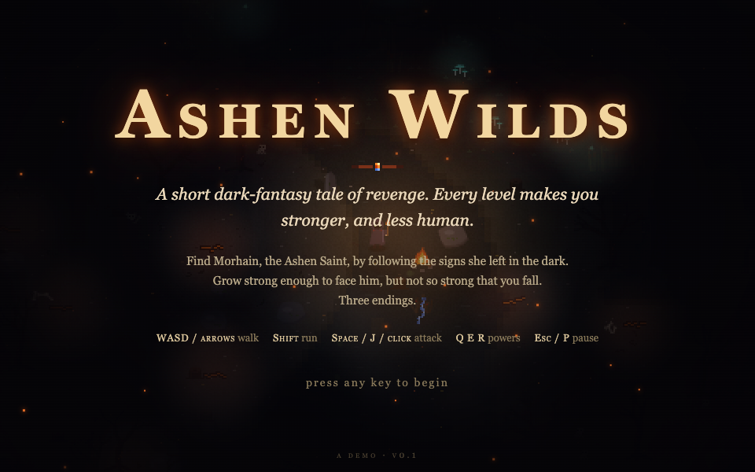
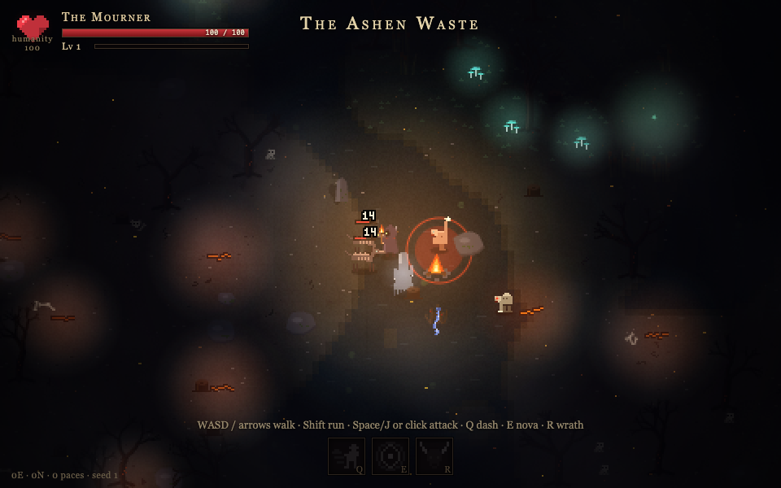
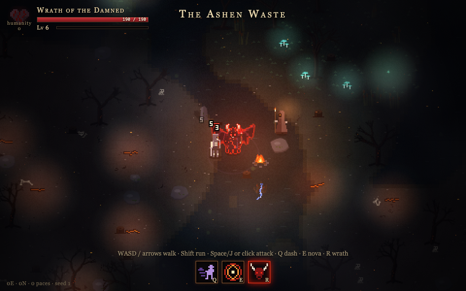
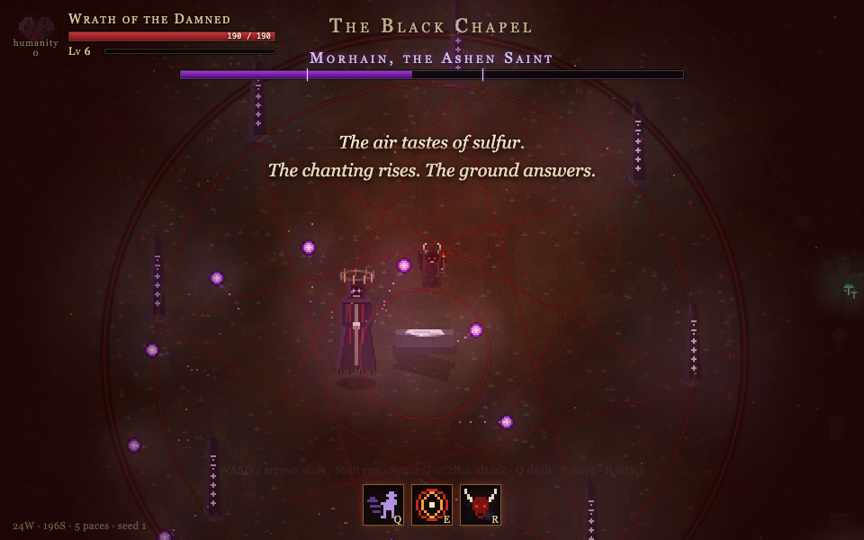

# Ashen Wilds

A dark-fantasy, top-down revenge tale that runs in the browser. You are the Mourner, and the world around
you never ends: it is generated on demand from a seed, so every wilderness is new and every place stays the
same when you come back to it. Morhain, the Ashen Saint, took Ilse on the night of the ash moon. To reach him
you climb a ladder of revenge, and each rung makes you stronger and less human. Follow Ilse's signs and the
warmth of her ribbon toward his lair. Arrive too weak and he kills you; become too strong and you fall into
the Pale Below. There are three endings.

**[Play it here](https://albedoweb.github.io/ashen-wilds/)**

| | |
|---|---|
|  |  |
|  |  |

## Controls

| Action | Keyboard | Touch |
|---|---|---|
| Walk | WASD / arrow keys | Drag |
| Run | Shift | |
| Attack (toward the cursor) | Space / J / mouse click | |
| Dash / Nova / Wrath | Q / E / R | |
| Pause | Esc / P | Pause button |

## Run it locally

No build step and no dependencies: open `index.html` in a browser. URL options include `?seed=123`,
`?x=500&y=-200` (start tile) and `?debug=1`; the full list is in [docs/API.md](docs/API.md).

## For agents and tinkerers

The game logic is a deterministic simulation in `src/sim.js`, separate from rendering, so it also runs
headless in Node 24. In the browser, `window.game` exposes `observe()`, `events()`, `act(action)`, `pause()`,
`speed()` and a live `config` object.

```
node tools/check.mjs                              # automated checks
node tools/sim.mjs --bot average --runs 30        # headless runs with scripted bots (novice, average, expert, rusher, grinder)
node tools/curves.mjs                             # component curves: time to kill, time to die, boss fight, XP per minute
node tools/llm_play.mjs --seed 3 --minutes 12     # LLM playtester
```

The LLM playtester reads its key only from the environment: `DEEPSEEK_API_KEY`, or `OPENROUTER_API_KEY` with
`--provider openrouter`. `--dry-run` needs no key.

- [docs/API.md](docs/API.md): how an agent plays and tunes the game
- [docs/DESIGN.md](docs/DESIGN.md): the design document
- [docs/BALANCE.md](docs/BALANCE.md): the balance log with metrics before and after each change

## Built with

Built with AI coding agents (Claude) and balanced with simulated and LLM playtests.

## License

[MIT](LICENSE)
